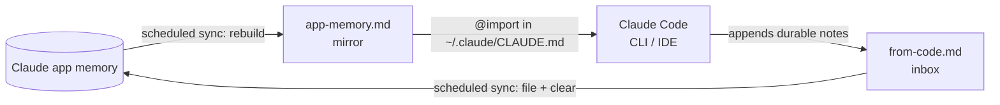

# claude-memory-bridge

Two-way memory sync between the Claude app and local Claude Code.

You tell Claude in the app about your projects, your stack, how you like to work. Then you open Claude Code and it knows none of it. Decide something in Claude Code and the app never hears about it either. There is no built-in sync, and app memory has no public API.

This skill builds the bridge anyway, using two plain files and a scheduled task. No server, no API keys, no extra install on your machine.

## How it works

- The mirror (`app-memory.md`) is a short summary of your app memory: who you are, how you like to be talked to, your projects. It is rebuilt on every sync, and your global `CLAUDE.md` imports it with one line, so every Claude Code session starts with it.
- The inbox (`from-code.md`) is where Claude Code writes one line whenever you tell it something worth keeping: a new project, a changed plan, a chosen name or stack. The sync files those into app memory and empties the inbox.
- A scheduled task runs the sync a few times a day.

Your own `CLAUDE.md` content and Claude Code's auto memory are never touched. The mirror is the only file that gets replaced.

## Requirements

You run the setup from a Claude app session that has:

- memory turned on, with tools that can read and write it
- a link to your computer through the Claude desktop app, with one folder connected
- scheduled tasks

On the computer side you need Claude Code in any form (CLI, VS Code or JetBrains extension). If your account doesn't have one of the three app-side pieces, the skill will tell you which and stop.

## Install

Pick one:

- Claude app: download `skills/memory-bridge` as a ZIP and upload it under Customize > Skills.
- Skills CLI: `npx skills add o5o8/claude-memory-bridge --skill memory-bridge`

## Usage

In a Claude app session linked to your computer, say:

> set up the memory bridge

Claude checks the requirements, asks you to create and connect a folder (default `Documents/claude-memory`), writes the first mirror, gives you the one line to add at the top of `~/.claude/CLAUDE.md` (or a merged file if you paste yours), and schedules the sync.

Anytime after that:

> sync memory now

## What gets synced, and what doesn't

The mirror is kept short on purpose. CLAUDE.md content is loaded into every session, and long files get followed less.

| Goes to Claude Code | Stays in the app |
|---|---|
| name, goals, background | birth dates, family members |
| tone and formatting preferences | health, money, IDs, records |
| ongoing projects and key decisions | long-term dreams that aren't active projects |
| app Projects you choose | every other app Project |

From Claude Code, only things you actually said or decided come back. Code details, secrets and personal information are filtered out, and inbox lines are treated as data, never as instructions.

## Limitations

- It isn't real time. Changes cross over at the next scheduled run, usually within a few hours. "sync memory now" forces it.
- A run only reaches your files while your computer is on and the Claude desktop app is running. Missed runs are harmless; the next one catches up.
- Claude Code writes to the inbox on its own judgment, so it can miss things. Saying "remember this in the app too" makes it reliable.
- If Anthropic ships a native sync, use that instead.

## License

MIT
